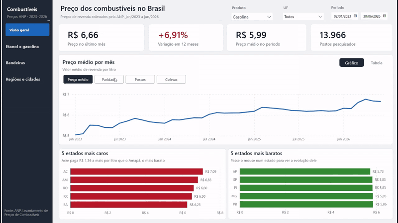
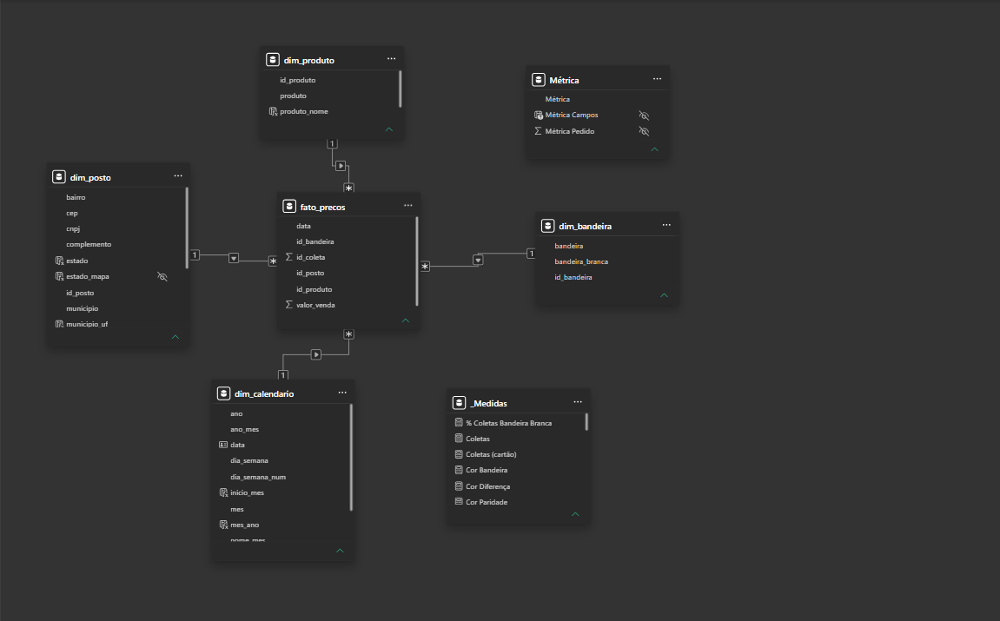
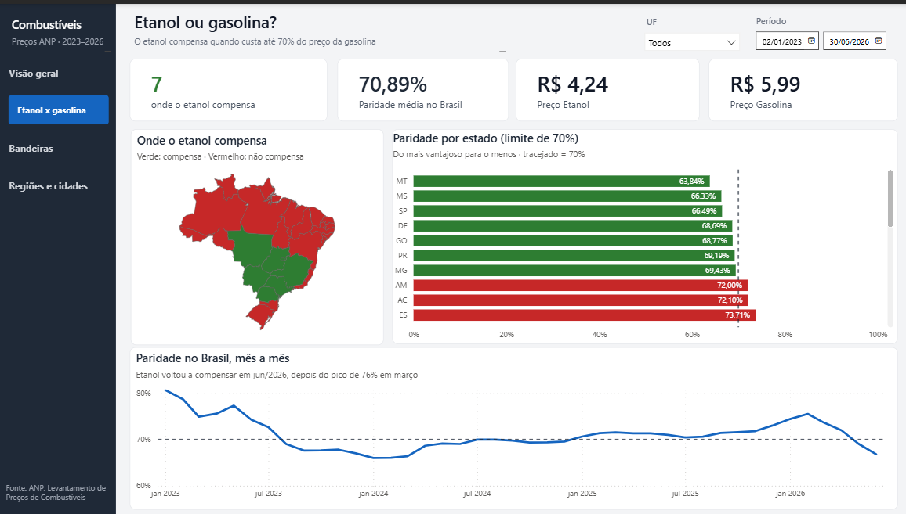
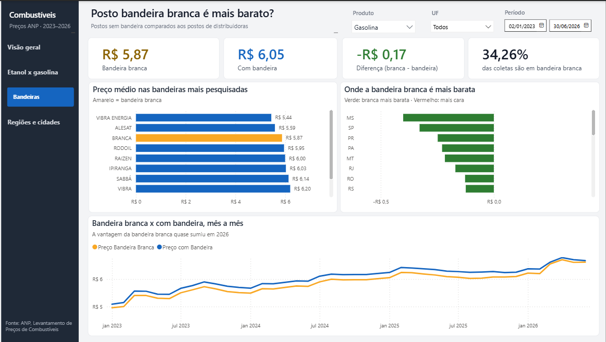
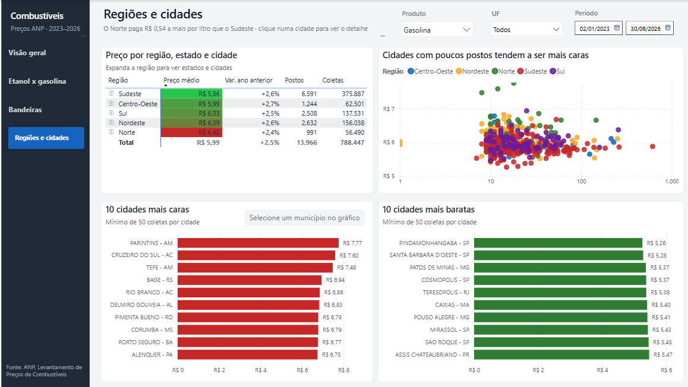
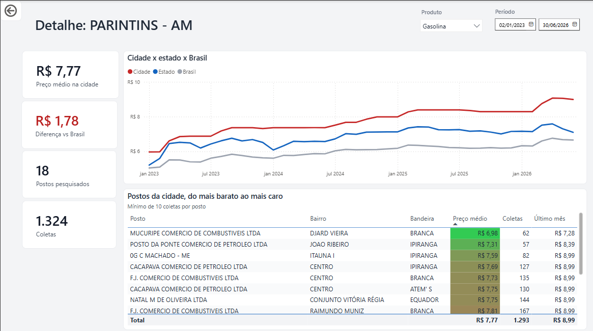
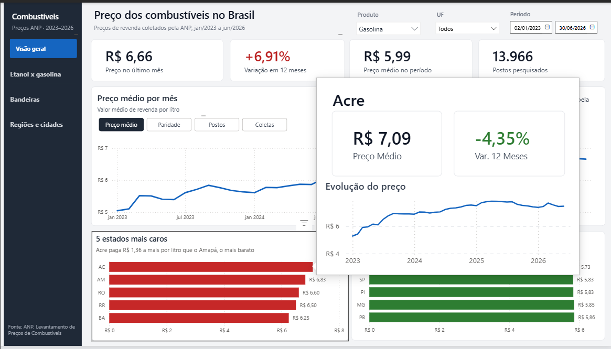
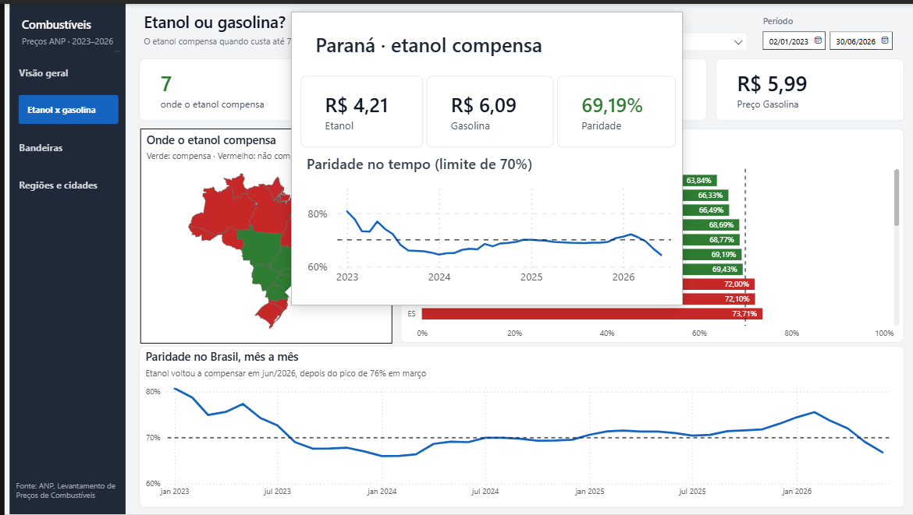

# Análise de preços de combustíveis no Brasil

Dashboard em Power BI com 3 milhões de preços coletados pela ANP entre janeiro de 2023 e junho de 2026. Os dados passam por um pipeline em Python e PostgreSQL antes de chegar no Power BI.



## O problema

A ANP publica os preços de revenda dos postos em arquivos CSV grandes, separados por semestre e com problemas de formatação. Do jeito que vêm, não dá para responder perguntas simples, como:

- Quanto o preço da gasolina subiu nos últimos 12 meses?
- Em quais estados o etanol compensa mais que a gasolina?
- Posto bandeira branca é mesmo mais barato?
- Quais cidades pagam mais caro, e por quê?

## Pipeline

```
CSVs da ANP (7 arquivos)
   │  Python (pandas): limpeza e padronização
   ▼
Parquet (3.029.555 linhas)
   │  Python (SQLAlchemy + COPY): carga
   ▼
PostgreSQL: schema staging
   │  SQL: modelo estrela
   ▼
PostgreSQL: schema analytics (4 dimensões + 1 fato)
   │
   ▼
Power BI: medidas DAX e dashboard
```

## Ferramentas

- **Python**: pandas, pyarrow, SQLAlchemy, psycopg2, python-dotenv
- **PostgreSQL 18** e pgAdmin
- **SQL**: modelo estrela com chaves, índices e validações
- **Power BI**: DAX, drill-through, dicas personalizadas, parâmetro de campo e indicadores

## Estrutura do repositório

```
├── notebooks/
│   ├── 01_exploracao.ipynb    # primeiro contato com os dados e problemas encontrados
│   └── 02_validacao.ipynb     # conferência do arquivo limpo
├── src/
│   ├── limpeza.py             # lê os CSVs, limpa e gera o Parquet
│   ├── conexao.py             # conexão com o PostgreSQL (lê o .env)
│   └── carga.py               # carrega o Parquet no schema staging
├── sql/
│   ├── 01_modelo_estrela.sql  # cria dimensões, fato, chaves e índices
│   └── 02_validacao.sql       # confere contagens e médias
├── powerbi/                   # arquivo do dashboard
└── imagens/                   # prints do dashboard
```

## Problemas encontrados nos dados

A exploração inicial mostrou vários problemas que precisaram de tratamento:

| Problema | Tratamento |
|---|---|
| 9.114 linhas totalmente vazias no fim de um arquivo | removidas (`dropna(how="all")`) |
| Coluna "Valor de Compra" 100% vazia | removida |
| Espaço no início de todos os CNPJs | `str.strip()` em todas as colunas de texto |
| CNPJ com pontuação em alguns arquivos e só números em outros | padronizado para 14 dígitos, só números |
| Unidade do GNV escrita como "m3" e "m³" | padronizada para "m³" (sem isso, o GNV virava dois produtos) |
| Datas em texto (dd/mm/aaaa) | convertidas para data; comparar como texto dava o máximo errado |
| Mesma distribuidora com dois nomes (VIBRA e VIBRA ENERGIA) | identificado; mantido como está na fonte |

## Modelo de dados

Esquema estrela no PostgreSQL, importado para o Power BI:

- **fato_precos**: uma linha por preço coletado (3.029.555 linhas)
- **dim_posto**: 14.059 postos, com cidade, estado e região
- **dim_produto**: 6 combustíveis
- **dim_bandeira**: 58 bandeiras, com indicação de bandeira branca
- **dim_calendario**: 1.276 dias

A bandeira fica na fato, e não no posto, porque um posto pode trocar de bandeira ao longo do tempo. Isso aparece nos dados.



## O dashboard

**Visão geral**: preço do último mês, variação em 12 meses, evolução mensal com seletor de métrica (preço, paridade, postos ou coletas), alternância entre gráfico e tabela, e os estados mais caros e mais baratos.

**Etanol x gasolina**: mapa e ranking da paridade por estado. O etanol compensa quando custa até 70% do preço da gasolina.

**Bandeiras**: comparação entre postos bandeira branca e postos de distribuidoras.

**Regiões e cidades**: matriz região > estado > cidade, dispersão de preço por número de postos e rankings de cidades. Ao clicar numa cidade, um botão leva para a página de detalhe.

**Detalhe do município** (drill-through): a cidade comparada ao estado e ao Brasil, e a lista de postos do mais barato ao mais caro.

| | |
|---|---|
|  |  |
|  |  |

Passando o mouse sobre um estado, aparece uma dica com a evolução daquele estado:

| | |
|---|---|
|  |  |

## Principais descobertas (gasolina, jan/2023 a jun/2026)

- A gasolina custou em média **R$ 5,99** no período e fechou junho de 2026 em **R$ 6,66**, alta de **6,91%** em 12 meses.
- O **Norte** paga em média **R$ 6,40**, contra **R$ 5,86** no Sudeste.
- **Parintins (AM)** foi a cidade mais cara (R$ 7,77) e **Pindamonhangaba (SP)** a mais barata (R$ 5,26), uma diferença de R$ 2,51 por litro.
- As cidades mais caras costumam ter **poucos postos pesquisados**, o que sugere menos concorrência.
- O **Acre** foi o estado mais caro do período, mas o preço lá **caiu 4,35%** em 12 meses, enquanto no Brasil subiu 6,91%.
- O etanol compensa em **7 estados**, todos no Centro-Sul: MT, MS, SP, DF, GO, PR e MG.
- A paridade nacional passou de cerca de 81% no início de 2023 para 66% no começo de 2024, subiu para 76% em março de 2026 e caiu para 67% em junho: o etanol voltou a compensar.
- Posto **bandeira branca** foi em média **R$ 0,17 mais barato**, mas a vantagem praticamente sumiu em 2026. No Acre e no Amazonas, o bandeira branca chega a ser mais caro.

## Como rodar

1. No [portal de dados abertos da ANP](https://www.gov.br/anp/pt-br/centrais-de-conteudo/dados-abertos), baixe os arquivos semestrais da **Série Histórica de Preços de Combustíveis** (combustíveis automotivos, 2023.01 a 2026.01) e coloque em `dados/raw/`.
2. Crie o ambiente e instale as dependências:
   ```bash
   python -m venv venv
   venv\Scripts\activate
   pip install -r requirements.txt
   ```
3. Crie o banco `combustiveis` no PostgreSQL e um arquivo `.env` na raiz:
   ```
   DB_USER=seu_usuario
   DB_PASSWORD=sua_senha
   DB_HOST=localhost
   DB_PORT=5432
   DB_NAME=combustiveis
   ```
4. Rode o pipeline:
   ```bash
   python src/limpeza.py
   python src/carga.py
   ```
5. Execute `sql/01_modelo_estrela.sql` no pgAdmin e, para conferir, `sql/02_validacao.sql`.
6. Abra o arquivo da pasta `powerbi/` e atualize a conexão com o seu banco.

## Próximos passos

- Automatizar o download dos arquivos da ANP
- Juntar as etapas num único script de pipeline
- Agendar a atualização com Airflow

## Autor

**Mateus Santos**, estudante de Análise e Desenvolvimento de Sistemas

[LinkedIn](https://www.linkedin.com/in/mateus-santosads)
